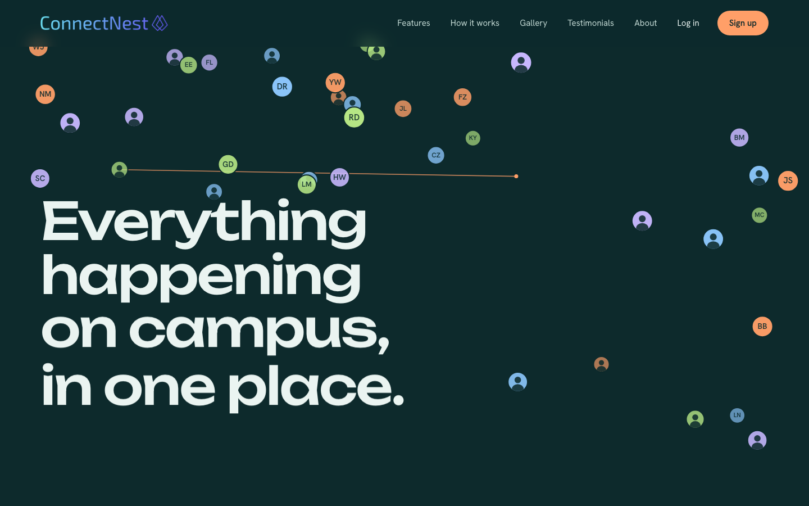

# ConnectNest

ConnectNest is a campus engagement platform that connects students with events,
groups, and each other. It is a React single-page app on a fully serverless AWS
backend, with all infrastructure defined as code using the AWS CDK.

Live site: **https://connectnestapp.com**

Built as a Harrisburg University senior capstone project (Project II).



## What this project demonstrates

- **Cloud architecture as code.** The whole platform (CDN, WAF, API, compute,
  data, auth, email, DNS, audit) is defined in AWS CDK across eight stacks and
  deploys with one command.
- **Serverless design.** Lambda, API Gateway, DynamoDB, and S3, with one table
  per entity, access-pattern-driven indexes, and a least-privilege IAM role per
  function.
- **Authentication and authorization.** Cognito with Google and Microsoft
  federation, JWT authorizers on every route, a token-verifying Lambda
  authorizer for WebSockets, and server-side membership checks. User identity
  always comes from the verified token.
- **Real-time features.** An API Gateway WebSocket API with a broadcast path
  from the write Lambdas to connected clients.
- **Trust and safety.** Text moderation plus Rekognition image scanning.
- **Production concerns.** Custom domain with TLS, branded transactional email
  with DKIM, audit logging, threat detection, and secrets kept out of source
  control.

## Features

- **Profiles:** major, interests, bio, avatar.
- **Events:** create, browse, edit, delete, RSVP, and attendee lists.
- **Groups:** create and join groups, a group detail page with member list and
  its own feed. Posting to a group is restricted to members, enforced on the
  server.
- **Social feed:** posts with likes and comments, plus image attachments.
- **Activity view:** a campus-wide digest of upcoming events, recent posts, and
  new groups.
- **Real-time updates:** new posts and events are pushed to connected clients
  over an API Gateway WebSocket API.
- **Sign-in:** email and password, Google, and Microsoft, with optional TOTP MFA
  enabled on the user pool.
- **Trust and safety:** server-side text moderation and automatic image scanning
  with Amazon Rekognition.
- **Account lifecycle:** deactivate, delete with a grace period, and a scheduled
  purge, with an audit log.

## Architecture

```
Users -> CloudFront (HTTPS) + AWS WAF
         |- default  -> S3 (private, Origin Access Control): React SPA
         '- /api/*   -> API Gateway (HTTP API v2, Cognito JWT authorizer)
                          -> Lambda (Node.js 22) -> DynamoDB (one table per entity)
                                                 -> S3 uploads -> Rekognition

Real-time: API Gateway WebSocket API -> Lambda -> connections table
Identity:  Amazon Cognito (email/password, Google, Microsoft, optional MFA)
Email:     Amazon SES (branded verification email from the project domain)
Security:  CloudTrail (audit), GuardDuty (threat detection), Secrets Manager,
           least-privilege IAM role per Lambda
DNS / TLS: Route 53 and ACM
```

| CDK stack | Contents |
|---|---|
| `ConnectNest-Data` | DynamoDB tables and indexes |
| `ConnectNest-Auth` | Cognito user pool, Hosted UI, Google and Microsoft providers, MFA, custom-message email trigger |
| `ConnectNest-Api` | HTTP API, JWT authorizer, Lambda handlers, uploads bucket, image moderation, scheduled purge |
| `ConnectNest-Hosting` | CloudFront, private S3 SPA bucket, WAF, ACM certificate |
| `ConnectNest-Realtime` | WebSocket API, connections table, connect/disconnect/authorizer Lambdas |
| `ConnectNest-Email` | SES domain identity with DKIM |
| `ConnectNest-Dns` | Route 53 hosted zone and records |
| `ConnectNest-Security` | CloudTrail and GuardDuty |

More detail: [docs/architecture.md](docs/architecture.md),
[docs/data-model.md](docs/data-model.md), and
[docs/aws-services.md](docs/aws-services.md).

## Repository layout

```
connectnest/
├── infra/       AWS CDK app (TypeScript): bin/app.ts composes the stacks in lib/
├── backend/     Lambda handlers (Node ESM, AWS SDK v3) and shared helpers
│   └── handlers/  profiles, events, posts, groups, activity, files, auth, realtime
├── frontend/    React SPA (Create React App)
│   └── src/       auth/, api/, realtime/, pages/, components/, styles/
├── docs/        architecture and data-model documentation
└── package.json root scripts (esbuild is used to bundle Lambdas)
```

## Getting started

### Prerequisites

- Node.js 20 or later
- An AWS account with the AWS CLI configured (`aws configure`)
- Docker is not required. Lambda bundling runs locally with esbuild.

### Install

```bash
npm install
(cd backend  && npm install)
(cd infra    && npm install)
(cd frontend && npm install)
```

### Configuration

Environment-specific values and secrets are passed to the CDK through
`infra/cdk.context.json`, which is gitignored and must never be committed. Copy
the template and fill in your own values:

```bash
cp infra/cdk.context.example.json infra/cdk.context.json
```

It covers the Google and Microsoft OAuth credentials, the site domain, and the
allowed callback, logout, upload, and CORS origins. The Google client secret is
stored in AWS Secrets Manager at deploy time and referenced dynamically.

For the frontend, copy `frontend/.env.example` to `frontend/.env` (and
`frontend/.env.production` for production builds) and set the Cognito pool ID,
client ID, Hosted UI domain, API URL, and WebSocket URL from your stack outputs.

### Verify without deploying

```bash
(cd backend  && npx tsc --noEmit)
(cd infra    && npx tsc --noEmit && npx cdk synth)
(cd frontend && npm run build)
```

### Deploy

Deploying creates real AWS resources that incur (small) charges until destroyed.

```bash
cd infra
npx cdk bootstrap          # one time per account and region
npx cdk deploy --all
```

The Email stack must be deployed first, and its DKIM records added to your DNS,
before `ConnectNest-Auth` can send mail through SES. After the first deploy, put
the stack outputs into the frontend env files, then build and publish the SPA:

```bash
(cd frontend && npm run build)
(cd infra && npx cdk deploy ConnectNest-Hosting)
```

Run the frontend locally with `cd frontend && npm start`.

### Tear down

```bash
cd infra && npx cdk destroy --all
```

## API

All routes require a Cognito JWT (`Authorization: Bearer <idToken>`). The user
identity always comes from the verified token, never from the request body.

| Method | Path | Purpose |
|---|---|---|
| GET, PUT | `/profiles/me` | Get or update the current profile |
| GET | `/profiles/{userId}` | Get a user's profile |
| POST | `/account/deactivate`, `/account/reactivate`, `/account/delete` | Account lifecycle |
| GET, POST | `/events` | List or create events |
| GET, PUT, DELETE | `/events/{eventId}` | Get, update, or delete an event (owner only for writes) |
| POST | `/events/{eventId}/rsvp` | RSVP or cancel |
| GET | `/events/{eventId}/rsvps` | Attendee list |
| GET | `/me/rsvps` | Events the current user RSVP'd to |
| GET, POST | `/posts` | List posts (`?groupId=` filters) or create a post |
| DELETE | `/posts/{postId}` | Delete own post |
| POST | `/posts/{postId}/like` | Toggle like |
| GET, POST | `/posts/{postId}/comments` | List or add comments |
| GET, POST | `/groups` | List or create groups |
| GET | `/groups/{groupId}` | Get one group |
| POST | `/groups/{groupId}/join` | Join a group |
| GET | `/groups/{groupId}/members` | List group members |
| GET | `/me/groups` | Groups the current user belongs to |
| GET | `/activity` | Campus activity digest |
| POST | `/uploads/presign` | Presigned image upload |
| GET | `/uploads/url` | Presigned image download URL |

## Testing

`scripts/smoke-test.py` invokes the deployed Lambda handlers with a synthetic
authenticated event and checks the main flows: events and RSVP, posts, likes,
comments, groups, the activity digest, profiles, content moderation, and upload
URLs (22 checks). It needs the AWS CLI configured for the target account and
writes a few test records, so run it against a development or demo stack.

```bash
python3 scripts/smoke-test.py
```

There is no automated browser or unit-test suite yet.

## Security

ConnectNest uses defense in depth. No single control is treated as sufficient.

- CloudFront with AWS WAF managed rules and rate limiting at the edge.
- A Cognito JWT authorizer on every API route; the WebSocket `$connect` route
  verifies the Cognito token in a Lambda authorizer.
- Least-privilege IAM, one role per Lambda.
- Private S3 buckets (public access blocked, encrypted). Uploads use short-lived
  presigned URLs restricted to an image allowlist and a size cap.
- Group-scoped writes verify membership on the server.
- Text moderation on user content and Rekognition scanning of uploaded images.
- CloudTrail audit logging and GuardDuty threat detection.
- OAuth secrets live in AWS Secrets Manager and the gitignored CDK context, never
  in the repository or the frontend bundle.

## Project status

Implemented: authentication, profiles, events and RSVP, posts with likes and
comments, groups with member-gated posting, image upload and display with
moderation, the activity view, real-time push, and the production deployment.

Known gaps and planned work:

- Personalized recommendations are not built yet.
- Comment editing and deletion are not built yet.
- MFA is enabled on the user pool, but there is no in-app enrollment screen yet.
- There is no automated UI or unit test suite. The backend is covered by the
  scripted smoke test described above.
- Microsoft sign-in works for personal Microsoft accounts. Organizational
  accounts require tenant approval from the institution.

## Credits and license

Code is released under the [MIT License](LICENSE).

The Harrisburg skyline photo on the landing page is by Jeffrey Hayes, licensed
CC BY 2.0, via Wikimedia Commons. The other campus photos are used for this
academic project and remain the property of their respective owners; they are
not covered by the MIT license.
