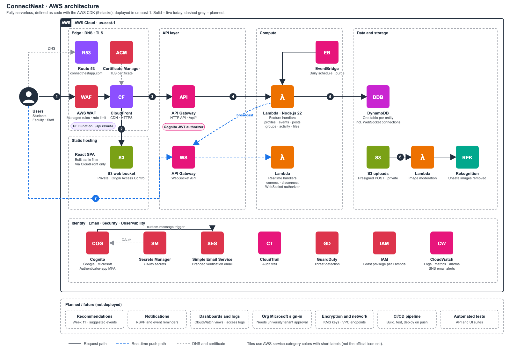

# ConnectNest — Architecture

ConnectNest is a serverless campus engagement platform for Harrisburg University
students. The frontend is a React single-page app; the entire backend and
infrastructure are defined as code with the AWS CDK and deployed to AWS account
us-east-1. The app is live at **https://connectnestapp.com**.

## Architecture diagram



How a request flows (numbers match the diagram):

1. The browser resolves `connectnestapp.com` in Route 53 and reaches CloudFront over HTTPS (ACM certificate), filtered by AWS WAF.
2. CloudFront serves the React app from a private S3 bucket (Origin Access Control).
3. Calls to `/api/*` are forwarded to API Gateway (HTTP API).
4. A Cognito JWT authorizer validates the token, then the matching Lambda runs.
5. The Lambda reads and writes DynamoDB (one table per entity).
6. Images upload to a private S3 bucket through a presigned URL; a Lambda sends them to Rekognition and deletes unsafe ones.
7. Real-time: the browser keeps a WebSocket connection (authenticated with its Cognito token). When a post or event is created, the write Lambda pushes it to connected clients.

Sign-in runs through Cognito (email, Google, Microsoft; OAuth secrets in Secrets Manager). A Cognito custom-message trigger Lambda builds the branded verification email, which SES sends. A CloudFront Function rewrites `/api/*` paths before they reach API Gateway. An EventBridge rule runs a daily Lambda that permanently deletes accounts past their 30-day deletion window. CloudTrail, GuardDuty, IAM, and CloudWatch cover audit, threat detection, permissions, and logs. CloudWatch alarms on CloudFront 5xx, WAF blocks, API 5xx and Lambda errors notify the owner through SNS email. Users can turn on authenticator-app MFA from Settings.

The dashed "Planned / future" row in the diagram lists work that is not deployed yet: recommendations, notifications, a CloudWatch dashboard and access logging, KMS keys and VPC endpoints, CI/CD, automated tests, and organizational Microsoft sign-in.

## High-level diagram (text version)

```
                         Internet (HTTPS)
                              │
                     ┌────────▼─────────┐
                     │    CloudFront    │  ← AWS WAF (managed rules + rate limit)
                     │  connectnestapp  │     TLS via ACM; apex ALIAS in Route 53
                     │      .com        │
                     └───┬──────────┬───┘
            default      │          │   /api/*  (CloudFront Function strips /api)
                         ▼          ▼
                  ┌───────────┐  ┌──────────────────┐
                  │ S3 (SPA)  │  │  API Gateway     │
                  │ private,  │  │  HTTP API v2     │──▶ Cognito JWT authorizer
                  │ OAC only  │  └────────┬─────────┘
                  └───────────┘           │
                                   ┌──────▼──────┐
                                   │   Lambda    │  per-feature handlers
                                   │  handlers   │  (profiles, events, posts,
                                   └──────┬──────┘   groups, files, account)
                                          │
                        ┌─────────────────┼──────────────────┐
                        ▼                 ▼                  ▼
                 ┌────────────┐    ┌────────────┐    ┌──────────────┐
                 │  DynamoDB  │    │     S3     │    │  Rekognition │
                 │ per-entity │    │  uploads   │    │  (image      │
                 │   tables   │    │ (presigned)│    │  moderation) │
                 └────────────┘    └────────────┘    └──────────────┘

   Auth:  Amazon Cognito (email/password + Google + Microsoft via Hosted UI,
          optional TOTP MFA). Branded email via Amazon SES (connectnestapp.com).

   Real-time: API Gateway WebSocket API pushes post.created /
          event.created events to connected clients (no page refresh).

   Account-wide security: CloudTrail (audit) + GuardDuty (threat detection).
```

## CDK stacks (deployed)

| Stack | Contents |
|---|---|
| `ConnectNest-Data` | DynamoDB tables (one per entity) + GSIs, on-demand billing |
| `ConnectNest-Auth` | Cognito user pool, Hosted UI domain, Google + Microsoft IdPs, optional MFA, SES-backed branded email + custom-message Lambda trigger |
| `ConnectNest-Api` | HTTP API v2, Cognito JWT authorizer, Lambda handlers, least-privilege IAM, S3 uploads bucket, Rekognition image moderation, scheduled account purge |
| `ConnectNest-Hosting` | CloudFront + private S3 SPA (OAC), `/api/*` proxy behavior, CloudFront Function prefix strip, CLOUDFRONT-scoped WAF, ACM cert + apex/www aliases, security response headers (HSTS, nosniff, frame deny, referrer, permissions) |
| `ConnectNest-Security` | CloudTrail (multi-region audit trail → private S3) + GuardDuty detector |
| `ConnectNest-Monitoring` | CloudWatch alarms (CloudFront 5xx rate, WAF blocked requests, HTTP API 5xx, Lambda errors) → SNS email topic |
| `ConnectNest-Email` | Amazon SES domain identity (connectnestapp.com) with Easy DKIM |
| `ConnectNest-Dns` | Route 53 public hosted zone for connectnestapp.com (apex ALIAS → CloudFront, DKIM/SPF/ACM records) |
| `ConnectNest-Realtime` | API Gateway WebSocket API ($connect JWT authorizer, $disconnect, $default), Connections DynamoDB table; createPost/createEvent broadcast new items |

## Services

| Layer | Service | Responsibility |
|---|---|---|
| DNS | Amazon Route 53 | Authoritative DNS for connectnestapp.com (apex ALIAS to CloudFront) |
| Edge / CDN | Amazon CloudFront + AWS WAF | Global HTTPS delivery; single public entry; managed-rule + rate-limit protection |
| TLS | AWS Certificate Manager | Certificate for connectnestapp.com / www |
| Hosting | Amazon S3 (private, OAC) | React SPA static assets, reachable only via CloudFront |
| Auth | Amazon Cognito | Sign-up/in, tokens, Google + Microsoft federation, optional TOTP MFA |
| Email | Amazon SES | Branded transactional email (verification / password reset) from the domain |
| API | API Gateway (HTTP API v2) | Public REST entry; validates the Cognito JWT before routing |
| Real-time | API Gateway (WebSocket API) | Push post/event updates to connected clients |
| Compute | AWS Lambda (Node 22, ARM64, ESM) | Stateless business logic per feature |
| Data | Amazon DynamoDB | Profiles, events, RSVPs, posts, comments, likes, groups, members, audit log, connections |
| Storage | Amazon S3 | User image uploads via presigned POST (image allowlist + size cap) |
| Trust & Safety | Amazon Rekognition | Auto-moderates uploaded images (nudity/violence → deleted) |
| Secrets | AWS Secrets Manager | Google OAuth client secret (dynamic reference, not in template) |
| Observability / Audit | CloudTrail + GuardDuty + CloudWatch | Account-wide audit trail, threat detection, logs/metrics |
| Identity | IAM | Least-privilege role per Lambda |

## Security principles

- Authentication delegated to Cognito — no custom password/JWT handling.
- Every protected HTTP route sits behind a Cognito JWT authorizer; the WebSocket
  `$connect` validates the Cognito id token via a Lambda authorizer.
- Handlers derive the user id from the verified JWT claim
  (`event.requestContext.authorizer.jwt.claims.sub`), never from the request body.
  Owner-only mutations verify `ownerId === userId`; group-scoped writes verify
  GroupMembers membership.
- Each Lambda receives only the table/bucket permissions it needs via CDK
  `grant*` calls (least privilege).
- Private S3 buckets (BLOCK_ALL public access, SSE); uploads via short-lived
  presigned POST constrained to an image allowlist and size cap.
- Secrets live in Secrets Manager / gitignored CDK context — never in the repo
  or the frontend bundle.
- Defense-in-depth at the edge (WAF), identity (Cognito + MFA), content
  (text block-list + Rekognition), and detection (CloudTrail + GuardDuty).

## Content moderation

- **Text** (posts, comments, events, groups): a server-side block-list rejects
  profanity / slurs / offensive content with a 400 before storage;
  obfuscation-tolerant.
- **Images**: Amazon Rekognition scans each upload on an S3 ObjectCreated event
  and deletes any with explicit/violent content so it can never be served.

## Account lifecycle

Deactivate / soft-delete (30-day grace) / scheduled hard-purge across all tables
+ Cognito, with an AuditLog table recording actions. Logging in reactivates a
deactivated or pending-deletion account.

## Frontend integration

- `amazon-cognito-identity-js` handles Cognito flows, isolated in
  `frontend/src/auth/auth.js`. OAuth (Google/Microsoft) uses the Cognito Hosted
  UI redirect flow (`frontend/src/auth/oauth.js`).
- `AuthContext` exposes the signed-in user and auth actions.
- `api/client.js` attaches the Cognito id token as a Bearer credential and points
  at the API base (same-origin `/api` in production via CloudFront).
- In production the SPA calls the API same-origin through CloudFront's `/api/*`
  behavior, so there is no CORS and no cross-origin exposure.
- Real-time: a WebSocket client connects with the Cognito id token
  and applies pushed post/event updates live; it degrades gracefully to
  fetch-on-load if the socket is unavailable.

## Group and activity endpoints

- `GET /groups/{groupId}` returns a single group (read-only Lambda with read
  access to the Groups table only). The group detail page pairs it with
  `GET /groups/{groupId}/members` and `GET /posts?groupId=` to render a group's
  own feed. Posting into a group is still gated server-side on GroupMembers
  membership.
- `GET /activity` is a read-only aggregator Lambda that scans Events, Posts, and
  Groups in parallel and returns upcoming events (soonest first), the newest
  posts, and the newest groups in one response, so the Activity page needs a
  single request.
